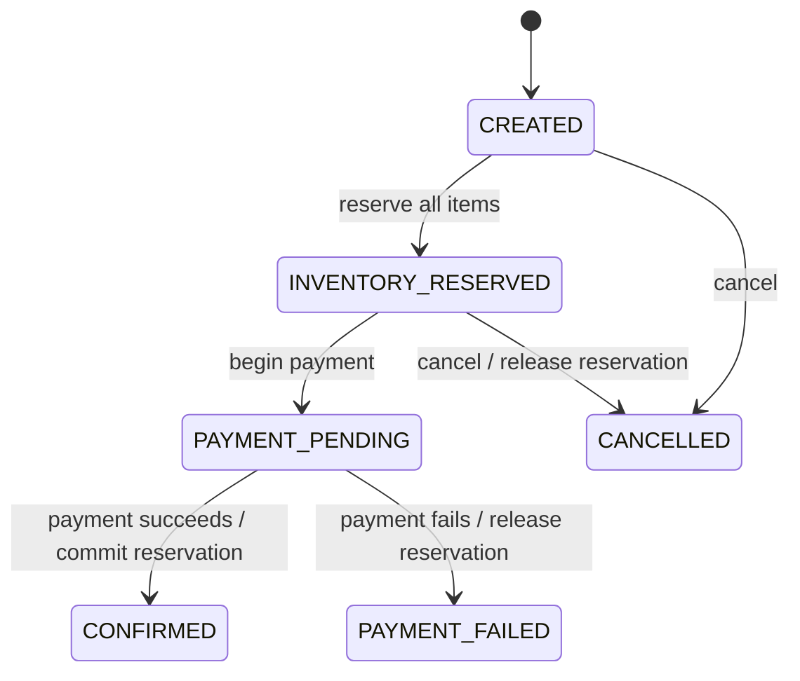

# Order & Inventory Management System

A Java service that creates e-commerce orders, reserves inventory without overselling,
simulates payment, confirms successful orders, and releases stock after payment failure
or cancellation.

The solution is intentionally a **modular monolith**: it is small enough to review and run
locally, while its transaction boundaries, ports, state model, database migrations,
observability, and deployment assets provide a clear path to production.

## Assessment requirements covered

| Requirement | Implementation |
|---|---|
| Create order | `POST /api/v1/orders` |
| Check inventory | Product responses expose available and reserved quantities |
| Reserve inventory | Conditional SQL update inside the order transaction |
| Simulate payment | `POST /api/v1/orders/{id}/payments` |
| Confirm order | Successful payment transitions the order to `CONFIRMED` |
| Cancel order | `POST /api/v1/orders/{id}/cancellations` |
| Release inventory | Payment failure and cancellation use compensating updates |
| Prevent overselling | The database atomically checks and decrements available stock |
| Handle concurrent orders | Integration test starts 30 orders against 10 units |
| Tests | Domain, application integration, HTTP, rollback, idempotency, and concurrency tests |
| Production-oriented design | PostgreSQL profile, Flyway, health/metrics, Docker, CI, graceful shutdown, correlation IDs |

## Order lifecycle



The payment gateway call is made **outside** a database transaction. A short transaction
first records `PAYMENT_PENDING`; the gateway is then called; a second short transaction
commits or releases the reservation. The persisted payment attempt and required
`Idempotency-Key` make retries safe.

## Technology

- Java 21
- Spring Boot 3.5.16
- Spring MVC, Validation, Data JPA, and Actuator
- Flyway database migrations
- H2 in PostgreSQL compatibility mode for zero-setup local execution
- PostgreSQL for the container/production profile
- Maven, JUnit 5, AssertJ, MockMvc, and JaCoCo
- Docker Compose and GitHub Actions

## Run locally

### Prerequisites

- Java 21 or newer
- `curl` or another HTTP client
- Docker only when using PostgreSQL/containers

The repository includes `mvnw` and `mvnw.cmd`. On the first invocation they download and
verify Apache Maven 3.9.11 into `.mvn/dist`; a system Maven installation is not required.

### Start with the embedded H2 database

```bash
./mvnw spring-boot:run
```

The default database is persisted under `./data`, so data survives application restarts.
Flyway creates the schema and inserts the assessment's sample catalog.

Check readiness:

```bash
curl http://localhost:8080/actuator/health
```

### Start the complete PostgreSQL stack

```bash
docker compose up --build
```

Stop it with:

```bash
docker compose down
```

Remove the PostgreSQL volume as well:

```bash
docker compose down --volumes
```

## Seeded products

| Product | ID | Initial available quantity | Price |
|---|---|---:|---:|
| Product A | `11111111-1111-1111-1111-111111111111` | 10 | USD 19.99 |
| Product B | `22222222-2222-2222-2222-222222222222` | 5 | USD 29.99 |
| Product C | `33333333-3333-3333-3333-333333333333` | 20 | USD 9.99 |

List the catalog and current inventory:

```bash
curl http://localhost:8080/api/v1/products
```

## API walkthrough

### 1. Create an order and reserve inventory

```bash
curl --request POST http://localhost:8080/api/v1/orders \
  --header 'Content-Type: application/json' \
  --data '{
    "customerReference": "customer-1001",
    "items": [
      {"productId": "11111111-1111-1111-1111-111111111111", "quantity": 2},
      {"productId": "22222222-2222-2222-2222-222222222222", "quantity": 1},
      {"productId": "33333333-3333-3333-3333-333333333333", "quantity": 5}
    ]
  }'
```

A successful response is `201 Created` and has status `INVENTORY_RESERVED`. Copy its
`orderId` for the next command.

### 2. Simulate successful payment

```bash
curl --request POST http://localhost:8080/api/v1/orders/ORDER_ID/payments \
  --header 'Content-Type: application/json' \
  --header 'Idempotency-Key: payment-customer-1001-001' \
  --data '{"outcome":"SUCCESS"}'
```

The order becomes `CONFIRMED`; reserved quantity is consumed. Repeating the exact request
with the same key is safe and does not consume stock twice.

### 3. Simulate payment failure

Create another order, then run:

```bash
curl --request POST http://localhost:8080/api/v1/orders/ORDER_ID/payments \
  --header 'Content-Type: application/json' \
  --header 'Idempotency-Key: payment-customer-1002-001' \
  --data '{"outcome":"FAILURE"}'
```

The order becomes `PAYMENT_FAILED`; all of its reserved quantities return to available
inventory in the same completion transaction.

### 4. Cancel a reserved order

```bash
curl --request POST http://localhost:8080/api/v1/orders/ORDER_ID/cancellations
```

Cancellation is idempotent. A confirmed or payment-pending order cannot be cancelled by
this endpoint; a production system would model refund and return workflows separately.

### 5. Create and restock products

```bash
curl --request POST http://localhost:8080/api/v1/products \
  --header 'Content-Type: application/json' \
  --data '{
    "sku": "PRODUCT-D",
    "name": "Product D",
    "unitPrice": 14.50,
    "initialQuantity": 25
  }'
```

```bash
curl --request POST http://localhost:8080/api/v1/products/PRODUCT_ID/restocks \
  --header 'Content-Type: application/json' \
  --data '{"quantity":10}'
```

In a real deployment, product and restock endpoints would require administrative
authorization.

## Endpoint summary

| Method | Path | Purpose |
|---|---|---|
| `GET` | `/api/v1/products` | List products and inventory |
| `GET` | `/api/v1/products/{productId}` | Get one product and inventory |
| `POST` | `/api/v1/products` | Create product and initial inventory |
| `POST` | `/api/v1/products/{productId}/restocks` | Add available inventory |
| `POST` | `/api/v1/orders` | Create order and reserve all items |
| `GET` | `/api/v1/orders/{orderId}` | Get an order |
| `POST` | `/api/v1/orders/{orderId}/payments` | Simulate idempotent payment |
| `POST` | `/api/v1/orders/{orderId}/cancellations` | Cancel a reserved order |
| `GET` | `/actuator/health` | Health/readiness/liveness |
| `GET` | `/actuator/prometheus` | Prometheus metrics |

The full contract is in [`docs/openapi.yaml`](docs/openapi.yaml), and runnable IntelliJ/
VS Code HTTP examples are in [`docs/api-examples.http`](docs/api-examples.http).

## Why inventory cannot be oversold

Reservation uses one conditional database statement per product:

```sql
UPDATE inventory
   SET available_quantity = available_quantity - :quantity,
       reserved_quantity = reserved_quantity + :quantity
 WHERE product_id = :productId
   AND available_quantity >= :quantity;
```

Success is defined by an affected-row count of exactly one. The availability check and
decrement are therefore a single atomic database operation rather than a vulnerable
read-check-write sequence.

For multi-item orders:

1. Duplicate product lines are combined.
2. Product IDs are sorted so transactions acquire hot rows in a consistent order.
3. Every conditional update runs in one transaction.
4. If any item is unavailable, an exception rolls back every earlier reservation and the
   order is not persisted.

The database also enforces non-negative available and reserved quantities with check
constraints.

## Payment consistency and idempotency

Payment is a small compensating workflow:

1. Lock the order row.
2. Persist a unique payment attempt and move the order to `PAYMENT_PENDING`.
3. Commit the transaction.
4. Call the payment port using the supplied idempotency key.
5. Lock the order row again.
6. On success, decrement `reserved_quantity` and confirm the order.
7. On failure, move reserved quantity back to available and mark the order failed.

Only one payment attempt is allowed per order. The idempotency key is globally unique.
Concurrent retries serialize on the order row; a completed attempt returns the existing
result without applying inventory changes again.

If the process stops after step 2, retrying the same request resumes the pending attempt.
For a real external provider, the provider must also honor the same idempotency key. A
scheduled reconciliation worker is the natural next step for automatically recovering old
pending attempts.

## Tests

Run all tests and create the coverage report:

```bash
./mvnw clean verify
```

Reports are written to:

- `target/surefire-reports`
- `target/site/jacoco/index.html`

Important scenarios covered:

- Domain state transitions and invalid transitions
- Successful reservation and payment
- Payment failure and inventory release, including multi-item compensation
- Cancellation and idempotent cancellation
- Idempotent payment retry
- Rejection of a different payment key after an attempt exists
- Duplicate order lines combined into one reservation
- Full rollback when one item in a multi-item order is unavailable
- Confirmed order cannot be cancelled
- Validation and problem-response contracts
- Thirty concurrent orders competing for ten units; exactly ten succeed
- Twelve concurrent retries of one payment; inventory is committed exactly once

The concurrency test calls the real Spring transaction boundary and the real atomic SQL
repository against H2 in PostgreSQL mode. CI runs the complete suite on every push and pull
request.

## Project structure

```text
src/main/java/com/megharaj/orderinventory
├── catalog
│   ├── application       # Product/inventory use cases and views
│   ├── domain            # Product and Inventory entities
│   └── infrastructure    # JPA repositories and atomic inventory SQL
├── order
│   ├── application       # Create, reserve, query, cancel, and reservation service
│   ├── domain            # Order aggregate, items, state machine
│   └── infrastructure    # Order repository and row locking
├── payment
│   ├── application       # Payment orchestration, port, transaction stages
│   ├── domain            # Persisted payment attempt and statuses
│   └── infrastructure    # Repository and simulated gateway adapter
├── web
│   ├── catalog           # Product endpoints and requests
│   ├── order             # Order/payment endpoints and requests
│   └── common            # Correlation ID and problem responses
└── config                # Cross-cutting beans
```

This package-by-feature layout keeps related domain, application, and adapter code close
together without introducing distributed-system complexity prematurely.

## Configuration

| Environment variable | Default | Purpose |
|---|---|---|
| `SERVER_PORT` | `8080` | HTTP port |
| `DB_URL` | H2 file database | JDBC URL |
| `DB_USERNAME` | `sa` | Database user |
| `DB_PASSWORD` | empty | Database password |
| `DB_POOL_SIZE` | `16` | Maximum Hikari pool size |
| `DB_MIN_IDLE` | `2` | Minimum idle connections |
| `SPRING_PROFILES_ACTIVE` | none | Use `postgres` for PostgreSQL |

Example without Docker Compose:

```bash
SPRING_PROFILES_ACTIVE=postgres \
DB_URL=jdbc:postgresql://localhost:5432/order_inventory \
DB_USERNAME=order_app \
DB_PASSWORD=change-me \
./mvnw spring-boot:run
```

## Production readiness and scaling considerations

Implemented now:

- Schema migrations and database constraints
- PostgreSQL configuration
- Atomic stock mutation and deterministic reservation order
- Pessimistic order locking for payment/cancellation serialization
- No remote call inside a database transaction
- Persisted payment attempts and idempotency keys
- Graceful shutdown
- Health, liveness/readiness probes, metrics, and Prometheus endpoint
- Correlation IDs and sanitized problem responses
- Non-root container
- CI verification and dependency update configuration

Before exposing this service publicly:

- Add OAuth2/OIDC authentication and role-based authorization, especially for catalog and
  restock operations.
- Store secrets in a secret manager and require TLS between every component.
- Add rate limiting, request-size limits, audit events, and PII retention rules.
- Add idempotency for order creation and durable, uniquely identified stock adjustments.
- Replace the simulator with a provider adapter that uses timeouts, retries only for safe
  operations, circuit breaking, and provider-side idempotency.
- Add an outbox table and publisher so order events are emitted atomically with state
  changes.
- Add reconciliation for stale `PAYMENT_PENDING` attempts and alerting for consistency
  failures.
- Run PostgreSQL integration tests with Testcontainers in an environment where Docker is
  available, in addition to the fast H2 suite.
- Define SLOs, dashboards, distributed tracing, backup/restore tests, and migration
  rollback procedures.

Scaling path:

- Application instances are stateless and can be horizontally replicated behind a load
  balancer.
- PostgreSQL remains the source of truth. Read replicas can serve catalog/order reads, but
  reservation and payment writes must use the primary.
- Hot products serialize at their inventory row by design. At extreme contention, route
  commands by product to partitions or a queue, or shard inventory by product ID.
- Publish confirmed-order events through an outbox to independently scalable fulfilment,
  notification, and analytics consumers.
- Add pagination and indexed search before the catalog or order history becomes large.
- Retain idempotency records according to a documented window and archive old orders.

See [`docs/architecture.md`](docs/architecture.md) and the ADRs under [`docs/adr`](docs/adr)
for the rationale and alternatives.

## Assumptions and deliberate scope choices

- All prices use USD. Multi-currency conversion is outside this assessment.
- A confirmed order consumes stock and cannot be cancelled through the reservation
  endpoint; refunds/returns are separate business processes.
- One payment attempt is allowed per order. A failed order is terminal for this exercise.
- Product deletion and price changes are not exposed. Order items preserve price, SKU, and
  name snapshots.
- The local H2 profile optimizes evaluator convenience; PostgreSQL is the intended
  production database.
- The service is synchronous at the HTTP boundary to keep the exercise easy to run. The
  staged payment design can be moved behind a queue without changing the domain states.

## Create the public GitHub repository

The supplied archive includes the local `.git` directory and a sequence of small commits.
After extracting it, create an empty public repository on GitHub and run:

```bash
git remote add origin https://github.com/YOUR_USERNAME/order-inventory-management-system.git
git push --set-upstream origin main
```

Do not initialize the GitHub repository with a README or license because both are already
present locally.
