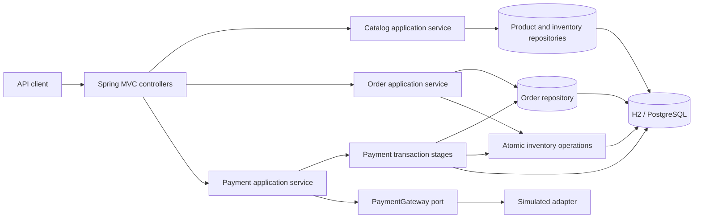

# Architecture

## Context

The service owns products, inventory, orders, and simulated payment attempts. It exposes a
synchronous HTTP API and persists all business state in one relational database.



## Boundaries

- **Web adapters** validate transport-level input and map exceptions to problem responses.
- **Application services** own use-case orchestration and transaction boundaries.
- **Domain objects** own order and payment state transitions.
- **Infrastructure adapters** implement persistence and the payment gateway port.

The implementation is a modular monolith. These boundaries can become separate services
only when operational or scaling evidence justifies the additional failure modes.

## Create and reserve sequence

```mermaid
sequenceDiagram
    participant C as Client
    participant O as OrderApplicationService
    participant P as ProductRepository
    participant I as InventoryRepository
    participant R as OrderRepository

    C->>O: create order
    activate O
    O->>P: load all products
    O->>O: combine duplicate lines and snapshot prices
    loop products sorted by product ID
        O->>I: conditional reserve update
        alt no row updated
            I-->>O: insufficient stock
            O-->>C: 409; transaction rolls back
        end
    end
    O->>R: persist INVENTORY_RESERVED order
    O-->>C: 201 Created
    deactivate O
```

## Payment sequence

```mermaid
sequenceDiagram
    participant C as Client
    participant T as PaymentTransactionService
    participant G as PaymentGateway
    participant I as InventoryRepository
    participant D as Database

    C->>T: prepare(order, key, outcome)
    T->>D: lock order; insert PENDING attempt and processing lease
    D-->>T: commit
    T-->>C: preparation with lease ownership
    C->>G: charge outside transaction
    G-->>C: success or failure
    C->>T: complete attempt
    T->>D: lock order
    alt success
        T->>I: commit reserved quantity
        T->>D: mark attempt SUCCEEDED and order CONFIRMED
    else failure
        T->>I: release reserved quantity
        T->>D: mark attempt FAILED and order PAYMENT_FAILED
    end
    D-->>T: commit
```

In code, `PaymentApplicationService` is the participant shown as the client between the two
transaction stages. No database connection or row lock is held while the gateway executes.

## Consistency model

### Inventory

`available_quantity` is stock that can still be reserved. `reserved_quantity` is stock held
for orders awaiting payment. A successful sale decreases reserved quantity; a failed or
cancelled order moves it back to available quantity.

The reservation update includes its precondition in SQL. This prevents two transactions
from both accepting the same last unit. Multi-item updates share one transaction, so the
order has either every reservation or none.

### Orders

The order aggregate permits only these transitions:

- `CREATED -> INVENTORY_RESERVED`
- `INVENTORY_RESERVED -> PAYMENT_PENDING`
- `PAYMENT_PENDING -> CONFIRMED`
- `PAYMENT_PENDING -> PAYMENT_FAILED`
- `CREATED | INVENTORY_RESERVED -> CANCELLED`

Payment and cancellation lock the order row. This serializes competing commands for the
same order without serializing unrelated orders.

### Payment

A unique constraint permits one payment attempt per order and one use of an idempotency
key globally. A database-backed processing lease grants only one request permission to call
the gateway. Concurrent retries with the same key and outcome observe the pending or
completed attempt; after a crashed owner's lease expires, one retry can take over. A retry
with different semantics is rejected.

## Failure cases

| Failure | Result |
|---|---|
| Product missing/inactive | No stock changed; request rejected |
| One item lacks stock | Whole reservation transaction rolls back |
| Payment declined | Entire reservation released; order marked failed |
| Duplicate payment request | Existing attempt reused; active lease prevents a simultaneous gateway call and duplicate stock mutation |
| Concurrent payment/cancel | Order row lock serializes commands; invalid loser is rejected |
| Process stops after payment preparation | Attempt remains pending; after the lease expires, the same key can claim and resume it |
| Consistency update affects no row | Transaction rolls back and emits a server error for alerting |

## Extensibility

The `PaymentGateway` interface isolates provider-specific behavior. A Stripe, Adyen, or
bank adapter can replace the simulator without changing order state transitions.

Order item snapshots allow product names and prices to evolve without rewriting historical
orders. Flyway makes schema evolution explicit. Application services return immutable
views, so the HTTP layer does not expose JPA entities.

Likely additions include promotions, tax, shipping, refunds, reservation expiry, and an
outbox. Each should be introduced as an explicit domain state or port rather than hidden in
controller code.

## Scaling

The service is stateless except for its database and can run multiple instances. Atomic SQL
and order locks remain correct across nodes. The principal write-contention point is a hot
inventory row, which is inherent when many buyers compete for the same finite stock.

For substantially higher throughput:

1. Partition inventory commands by product ID.
2. Use an outbox and broker for asynchronous fulfilment and notifications.
3. Keep PostgreSQL primary writes authoritative; use replicas only for tolerant reads.
4. Add pagination, archival, and time-partitioning for order/payment history.
5. Measure lock wait, payment latency, reservation failure rate, lease takeovers, and pending-attempt age.
